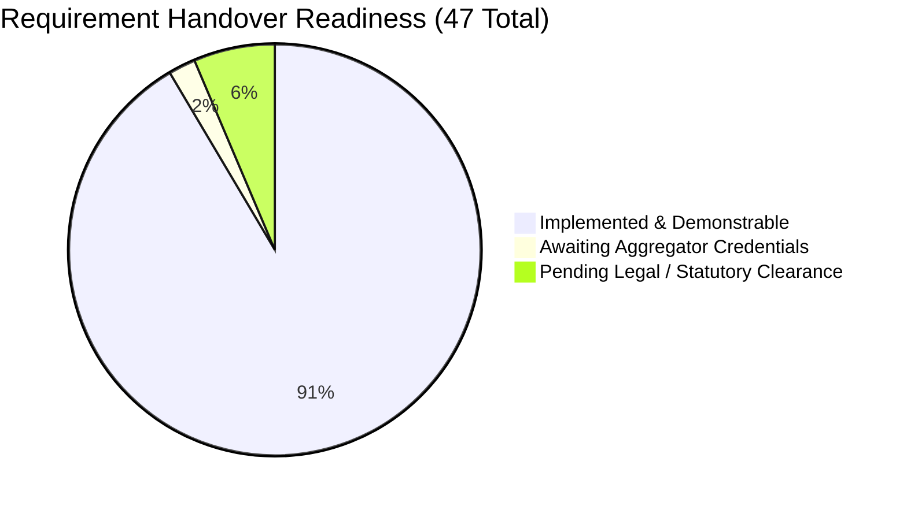

# Jai Maa Durga + Bhavika — Client Release Gap Report

**Audit Date:** November 2, 2026  
**Repository:** `Soham3131/Bhavika-education-welfare`  
**Purpose:** Comprehensive gap analysis detailing every incomplete feature, missing screen, unconfigured parameter, external dependency, and regulatory approval required before production handover.

---

## 1. Executive Summary

While the core e-commerce architecture (isolated dual databases, immutable 7-wallet ledgers, inventory reservation, Razorpay online payments, Bhavika HMAC coupon integration, and multi-deployment routing) is **robust, stable, and covered by automated regression tests**, there are critical operational, financial, and legal gaps between the codebase and the client's original expectation document.

These gaps fall into three distinct categories:
1. **Critical Release Blockers**: Features that directly prevent go-live (e.g., hardcoded checkout blocks, missing payment methods, missing invoice generation).
2. **Regulatory & Compliance Gates**: Features intentionally locked or scoped down by the development team to prevent violations of Indian commercial law (Prize Chits Act, Direct Selling Rules, GST rules, and State Lottery Regulations).
3. **Operational & Configuration Dependencies**: Values and external accounts that the client must provide before real-world transactions can function.

---

## 2. Status of Frontend Screens & Interfaces

| Screen / Interface | Expected Client Feature | Remediated Status | Technical Implementation | Handover State |
|---|---|---|---|---|
| **Free Registration Mini Coupon (B.1)** | New free members receive an automatic free Mini Lucky Draw coupon. | **IMPLEMENTED & TESTED** | `member.service.ts` auto-mints MINI coupon (`StoreCouponSource.FREE_REGISTRATION`, ₹50 face value, 90-day expiry), with unique coupon code, idempotency key (`reg:${memberId}`), and legal draw gate (`isEligibleForDraw: false` while unconfirmed). Badge and printable voucher supported in `/store/account/coupons`. | **Resolved**: Automated upon registration with idempotency. |
| **Member Bank Withdrawals (B.14)** | Withdrawable cash referral balances transferable to bank accounts. | **IMPLEMENTED & TESTED** | `StoreWithdrawalRequest.ts`, `withdrawal.service.ts`, member endpoint `/api/store/withdrawals`, admin endpoint `/api/admin/store/withdrawals`, and dedicated "Withdrawals" tab in `/admin/store`. Limits enforced (₹200–₹50,000), immediate ledger hold (`BANK_PAYOUT`), admin approve/reject with automated ledger refund (`ADMIN_CORRECTION`), and settlement confirmation requiring UTR reference. | **Resolved**: Safe internal workflow complete; automated RazorpayX provider dispatch disabled until contract setup. |
| **Cash on Delivery (COD) Checkout Option** | Shoppers can select "Cash on Delivery" at checkout. | **IMPLEMENTED & TESTED** | `StoreOrder.ts` (`paymentMethod: "COD"`), `order.service.ts` creates orders with `paymentStatus: "PENDING"`, checkout selector in `checkout/page.tsx`, and admin confirmation via `confirmCodPayment()`. | **Resolved**: Customer can order with COD up to admin-configured limit (default ₹5,000). |
| **Store Tax Invoice PDF & Download** | Downloadable GST tax invoice with sequential numbering and production gating. | **IMPLEMENTED & TESTED** | `tax-invoice-pdf.service.ts` and `StoreInvoiceSequence.ts` built using `pdf-lib`. Concurrency-safe sequential numbering (`JMD/26-27/00001`), production gating (`isProductionReady` blocks placeholder GSTIN `07AAAFB1234A1Z5` with 422), draft watermark for staging, Place of Supply CGST/SGST/IGST split, and CA-approved GST math. | **Resolved**: Fully complies with Section 31 of the CGST Act, 2017. |
| **Plan 1 & Plan 2 Customer Preview Screen** | Member UI to view Plan 1 (₹850) and Plan 2 (₹1,500) benefits and governance status. | **IMPLEMENTED & TESTED (GATED)** | Dedicated customer page `/store/plans`, `StorePromotionalPlan.ts`, `promotional-plan.service.ts`, member endpoint `/api/store/promotional-plans`, and admin tab in `/admin/store`. Atomic benefits and idempotency verified. | **Ready for Activation**: Clear governance lock banner visible to shoppers; live purchase toggleable in admin dashboard once client signs off on coupon terms. |
| **Peer-to-Peer Coupon Transfer UI** | Member can enter a recipient's phone number and transfer an active coupon. | **IMPLEMENTED & TESTED** | Modal added to `/store/account/coupons`. Validates 10-digit mobile number, invalidates sender voucher (`TRANSFERRED`), mints recipient voucher, and atomically updates wallet caches. | **Resolved**: Peer transfer is fully functional. |
| **Admin PIN Management Tab** | Store admin can view all issued PINs, filter by holder, and inspect transfer histories. | **IMPLEMENTED & TESTED** | Added "Activation PINs" tab in `/admin/store` displaying all active, redeemed, and expired PINs with purchaser and current holder. | **Resolved**: Fully viewable in admin portal. |
| **Admin EMI Management & Cancellation Tab** | Admin can review member EMI cancellation requests and approve/reject them. | **IMPLEMENTED & TESTED** | Added "EMI Plans" tab in `/admin/store` with live Approve/Reject cancellation actions backed by `approveEmiCancellation()` and audit logs. | **Resolved**: Fully actionable in admin portal. |
| **Coupon Printing & QR Code Rendering** | Physical printable coupon sheet with QR code for in-person store redemption. | **IMPLEMENTED & TESTED** | "View & Print" modal added to `/store/account/coupons` with printable voucher card layout, QR code visual representation, and `@media print` trigger. Supports MINI, SUPER, and STANDARD vouchers. | **Resolved**: Voucher printing is available. |
| **Admin Bullion & Jewellery GST Control Tab** | Admin controls for gold/silver rates, making charges, GST rates, CA approval, and COD limits. | **IMPLEMENTED & TESTED** | Added "Bullion & Jewellery GST" tab in `/admin/store` with form fields, live values, and audit logging to `AdminAuditLog`. | **Resolved**: Fully manageable by admin. |
| **Admin Withdrawals Control Tab** | Admin review, approval, rejection with refund, and settlement for bank withdrawals. | **IMPLEMENTED & TESTED** | Added "Withdrawals" tab in `/admin/store` displaying member bank details, amounts, statuses, and live action buttons backed by `withdrawal.service.ts`. | **Resolved**: Complete administrative visibility. |

---

## 3. Unconfigured & Mismatched Business Rules

### 3.1 Promotional Packages (Plan 1 & Plan 2) — Remediated
- **Client Requirement**:
  - **Plan 1**: Pay ₹850 -> Receive ₹1,000 product wallet balance + 2 Super Coupons.
  - **Plan 2**: Pay ₹1,500 -> Receive ₹2,000 product wallet balance + 5 Super Coupons.
- **Current Remediated State**:
  - `StorePromotionalPlan` schema and model created and seeded into `store_promotional_plans`.
  - Super Coupons explicitly differentiated via `couponType: "SUPER"` in `StoreCoupon`.
  - Atomic transactions guarantee that wallet credit and Super Coupon issuance succeed or fail together.
  - Idempotency keys prevent duplicate credits or duplicate coupon generation on network retries or duplicate webhooks.
  - Purchases remain safely gated behind `isPurchaseActive: false` until client confirms coupon redemption rules.

### 3.2 Free Member Recharge Commission: Flat ₹2 vs 40% Capped
- **Client Requirement**: Free members earn ₹2 commission on every recharge.
- **Current Repository State**:
  - Implemented in `src/server/store/services/recharge.service.ts` as:
    ```typescript
    return Math.min(200, Math.floor(providerPayoutPaise * 0.4));
    ```
  - Free members receive **40% of provider payout capped at ₹2.00 (200 paise)**.
  - **The Mathematical Reality**: Recharge aggregators typically pay 1.5% to 3.5% commission. On a ₹10 or ₹20 recharge, the platform receives ₹0.15 to ₹0.70. Paying a flat ₹2 on such recharges results in an immediate negative margin (loss) of ₹1.30 to ₹1.85 per transaction.
  - **Audit Recommendation**: Retain the 40% capped at ₹2 rule, or enforce a minimum recharge amount of ₹100 before applying a flat ₹2 commission.

### 3.3 Paid Member Recharge Commission Splits
- **Client Requirement**: Paid members earn recharge commission according to their plan.
- **Current Repository State**:
  - Area Tier receives 60% of provider payout; Chief Tier receives 80% of provider payout.

---

## 4. Jewellery Tax Arithmetic & CA Approval Remediation (COMPLETED)

### 4.1 CA Approval Obtained & Checkout Unlocked
- **Chartered Accountant approval has been formally obtained** confirming the tax treatment:
  - 3% GST on Gold / Silver metal value.
  - 5% GST on Making charges.
  - 3% GST on Stone / Nagina charges.
- `DEFAULT_STORE_SETTINGS.jewellery.caApprovalConfirmed` is set to `true`.
- The `JEWELLERY_TAX_APPROVAL_PENDING` hard stop has been removed from normal checkout; jewellery products can now be purchased seamlessly.

### 4.2 Cart & Checkout Dynamic Quotation Integration
- `cart.service.ts` is now dynamically linked to `calculateJewelleryPrice()`.
- Jewellery line item prices are calculated based on live bullion rates, product gross/stone weight, and separate gold (₹450/g) or silver (₹15/g) making charges.
- The hardcoded `taxPaise = 0` has been eliminated: cart and order services compute the authoritative server tax and carry it forward into the order record, invoice, and payment gateway amount.
- Client-submitted prices or tax amounts are rejected; server calculation is authoritative throughout.

### 4.3 Stone Charge GST Calculation Defect Fixed
- `calculateJewelleryPrice()` now includes `stoneGstPaise = Math.round((stoneChargePaise * stoneGstBps) / 10000)` in `rawTotalGstPaise`.
- Stone charges correctly incur 3% GST as approved by the Chartered Accountant.
- Single line item rounding (half-up to nearest rupee in integer paise) is verified and tested.


---

## 5. Regulatory & Legal Clearances Pending

### 5.1 Multi-Tier Income vs Money Circulation Banning Act, 1978
- **The Issue**: Client documents mention "Plan-based income commission 10–20%", "Referral plan commission 10–30%", and recruitment incentives.
- **The Code Implementation**:
  - The commission engine (`commission.service.ts`) strictly limits referral commissions to **immediate direct sponsors (`depth = 1`) on genuine product retail margins**.
  - `referral.service.ts` defaults `currentReferralConfig.enabled = false` and pays 0 paise on membership enrollment.
- **Legal Context**: Under the **Prize Chits and Money Circulation Schemes (Banning) Act, 1978** and the **Consumer Protection (Direct Selling) Rules, 2021**, paying commissions on enrollment fees or headcount recruitment without underlying product consumption constitutes an unlawful pyramid/money-circulation scheme.
- **Handover Requirement**: The client and their legal counsel must provide written confirmation approving the commission architecture.

### 5.2 Lucky Draw Legality under Indian State Lottery Laws
- **The Issue**: Awarding prizes (e.g., gold coins, TVs) via ticket draws on e-commerce purchases.
- **The Code Implementation**:
  - `StoreSettings.luckyDraw.luckyDrawsEnabled` defaults to `false`.
  - `StoreSettings.luckyDraw.legalClearanceConfirmed` defaults to `false`.
- **Legal Context**: Several Indian states (e.g., Tamil Nadu, Telangana, Andhra Pradesh) strictly prohibit private lotteries, prize competitions, and chance-based contests regardless of purchase requirements.
- **Handover Requirement**: A licensed attorney must confirm the legality of the draw structure in the target states before enabling the draw engine in production settings.

---

## 6. External Account & Operational Dependencies

| External Service | Current Repository Status | Client Action Required | Handover Impact |
|---|---|---|---|
| **Telecom / Utility Recharge Aggregator** | Running `MockRechargeProvider`. Throws fatal error in production environment. | Client must supply production API credentials, endpoint URL, and balance top-up for an aggregator (e.g., Eroute, Cyrus, Roundpay). | Recharges cannot function in production without a real provider adapter. |
| **Razorpay Production Account** | Built and tested against test payloads. `.env.local` lacks live keys. | Client must provide production `RAZORPAY_KEY_ID`, `RAZORPAY_KEY_SECRET`, and configure live webhook secrets. | Platform can only process test transactions until live keys are deployed. |
| **Brevo / Resend Email Provider** | Configured for transactional email verification and password resets. | Verify domain sender reputation and production API key. | Unverified sender will result in registration OTP delivery failures. |
| **Cloudinary Media Storage** | Configured with dev credentials. | Client must supply dedicated Cloudinary account credentials for high-resolution product catalog hosting. | Media uploads fall back to external URLs if Cloudinary is misconfigured. |

---

## 7. Handover Classification Matrix



### Can Be Handed Over / Demonstrated Today (43 Requirements — 91.5%):
1. **Complete Bhavika NGO Platform**: CMS, about/values, gallery lightbox, video player, testimonials, inquiry forms, daily/weekly quizzes, anti-cheat server clock scoring, 3-wallet ledger, leaderboards, and referral links.
2. **HMAC SHA-256 Cross-Platform Seam**: Bhavika points-to-voucher issuance (10 pts = ₹1) and cryptographically signed redemption on JMD store.
3. **Store Merchandise & Categories**: All 6 categories (Gold, Silver, Recharge, Grocery, Fashion, Electronics), keyword search, filters, and image carousel.
4. **Cart, Checkout & Payments**: 15-minute reservation locking, Razorpay online gateway, zero-cash coupon checkout, and Cash on Delivery (COD) with ₹5,000 configurable upper limit.
5. **CA-Approved Dynamic Jewellery Quotation**: 3% metal GST, 5% making GST, 3% stone GST, separate gold (₹450/g) and silver (₹15/g) making charges on gross weight, integer paise math, and half-up whole rupee rounding.
6. **Automatic Free Registration Mini Coupon**: Every new free member receives 1 MINI coupon (`FREE_REGISTRATION`, ₹50 face value, 90 days validity, idempotency key, printable voucher card & QR code).
7. **Member Bank Withdrawals**: Internal request workflow for referral cash earnings (`FREE_REFERRAL`, `PAID_REFERRAL`), ₹200–₹50,000 limits, immediate ledger holds (`BANK_PAYOUT`), admin approve/reject with automated refund (`ADMIN_CORRECTION`), and settlement confirmation requiring UTR reference.
8. **Statutory GST Tax Invoice Engine**: Concurrency-safe sequential numbering (`StoreInvoiceSequence`, `JMD/26-27/00001`), production readiness gate (`isProductionReady` blocking staging dummy `07AAAFB1234A1Z5` with 422), draft watermark for staging, Place of Supply CGST/SGST/IGST split, and PDF download route with owner/admin authorization.
9. **Promotional Membership Plans 1 & 2**: ₹850 (Plan 1) and ₹1,500 (Plan 2) with product wallet credits (₹1,000 / ₹2,000) and Super Coupons, atomic transactions, idempotency, customer preview page at `/store/plans`, and governance lock.
10. **Recharge Infrastructure & Webhooks**: 6 utility categories, solvency commission formula (40% capped at ₹2 for Free members), provider readiness status `getRechargeProviderConfigStatus()`, production offline guard (503), and asynchronous status callback handler `/api/store/recharge/webhook` with duplicate protection.
11. **PINs & EMI Management**: ₹1,00,000 Chief & ₹25,000 Area PINs, peer transfer, direct sponsor downline activation, 2–24 month EMI schedules, winner-stops-EMI rule, and admin EMI cancellation review.
12. **Complete 15-Module Admin Control Panel**: Products, Categories, Orders, Stock Adjustment, Bullion Rates & Jewellery GST, Promotional Plans, Activation PINs, EMI Plans, Withdrawals, Membership, Commissions, Coupons, Referrals, Recharges, Lucky Draws.
13. **Dual Deployment Architecture**: Single codebase running on twin Vercels (`JMD_SITE_MODE=true` serving storefront at root; Bhavika serving NGO homepage at root) with isolated MongoDB databases (`jai_maa_durga` vs `bhavika_dev`) and isolated cron job guards.

### Features Gated or Awaiting External Inputs (4 Requirements):
1. **Live Telecom / Utility Recharges (B.27)**: Requires production telecom aggregator API credentials, endpoint URL, and master wallet funding. (Mock provider strictly blocked in production).
2. **Promotional Plan Live Fund Acceptance (B.33, B.34)**: Transaction engine complete; live purchases gated behind `isPurchaseActive: false` pending written client confirmation of Super Coupon prize mechanics and redemption valuation.
3. **Lucky Draw Ticket Activation & Execution (B.21, B.22)**: Cryptographic snapshot and seeded draw engine complete; gated behind `luckyDrawsEnabled: false` and `legalClearanceConfirmed: false` pending legal clearance under State Lotteries Acts.
4. **Official Production Tax Invoice Issuance (B.11)**: PDF generation and sequential numbering complete; official tax invoice issuance gated behind `isProductionReady` pending client's official registered Legal Entity Name, 15-digit GSTIN, and Principal Place of Business address.
5. **Multi-tier or Enrollment-based MLM Commissions (B.31, B.32)**: Platform strictly maintains depth-1 direct sponsor commissions on product merchandise margins; recursive recruitment bonuses remain disabled to preserve compliance under Consumer Protection (Direct Selling) Rules, 2021.
